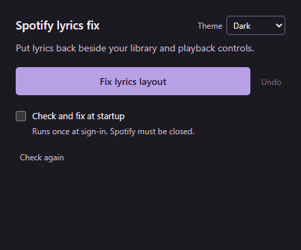
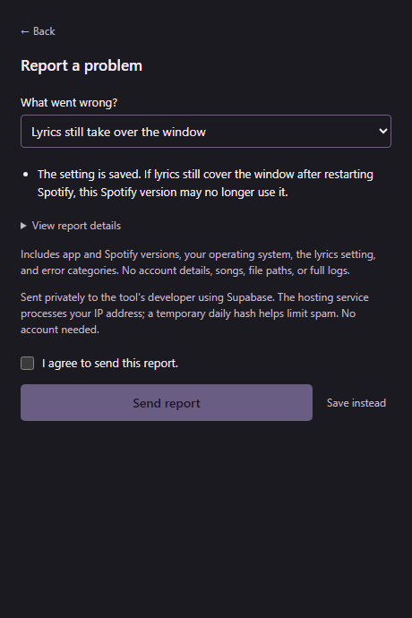

# Spotify lyrics fix

Puts lyrics back beside your library and playback controls.

**[Windows (.exe)](https://github.com/Colbyco/spotify-classic-lyrics/releases/latest/download/Classic-Lyrics-Setup-1.0.3.exe)** · **[Mac (.dmg)](https://github.com/Colbyco/spotify-classic-lyrics/releases/latest/download/Classic-Lyrics-1.0.3-macOS-Universal.dmg)** · [All downloads](https://github.com/Colbyco/spotify-classic-lyrics/releases/latest)

Windows 10/11 x64 · macOS 13+, Intel and Apple silicon.

<table>
<tr><th>Main window</th><th>Report a problem</th></tr>
<tr>
<td valign="top"></td>
<td valign="top"></td>
</tr>
</table>

[Light mode screenshot](docs/images/app-light.png)

## Use it

1. Install the Windows download, or open the Mac download and drag **Classic Lyrics** to Applications.
2. Open it and click **Fix lyrics layout**. It asks before restarting Spotify if needed.
3. Open Lyrics in Spotify. **Undo** restores your previous setting.

Appearance follows your system by default. Use **Theme** to choose **Dark** or **Light**.

Windows builds are unsigned; the Mac app is not notarized. Your OS may show a warning.

## Startup check

Optional **Check and fix at startup** runs once when the helper starts. At sign-in, it checks and exits. Spotify must be closed for automatic repair.

## Problems & privacy

**Report a problem** runs local checks and lets you review a private report before sending. No account needed. Nothing is sent without permission, and reports exclude Spotify account details, songs, and full logs.

[Technical details, privacy, and development](docs/details.md).

MIT licensed. Not affiliated with Spotify.
